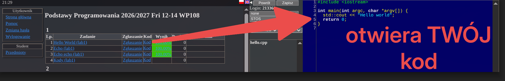
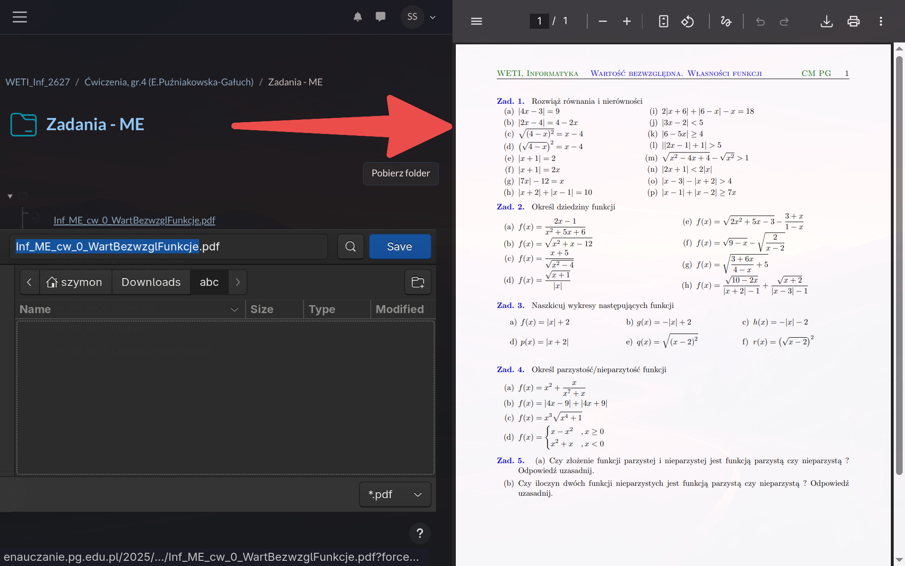
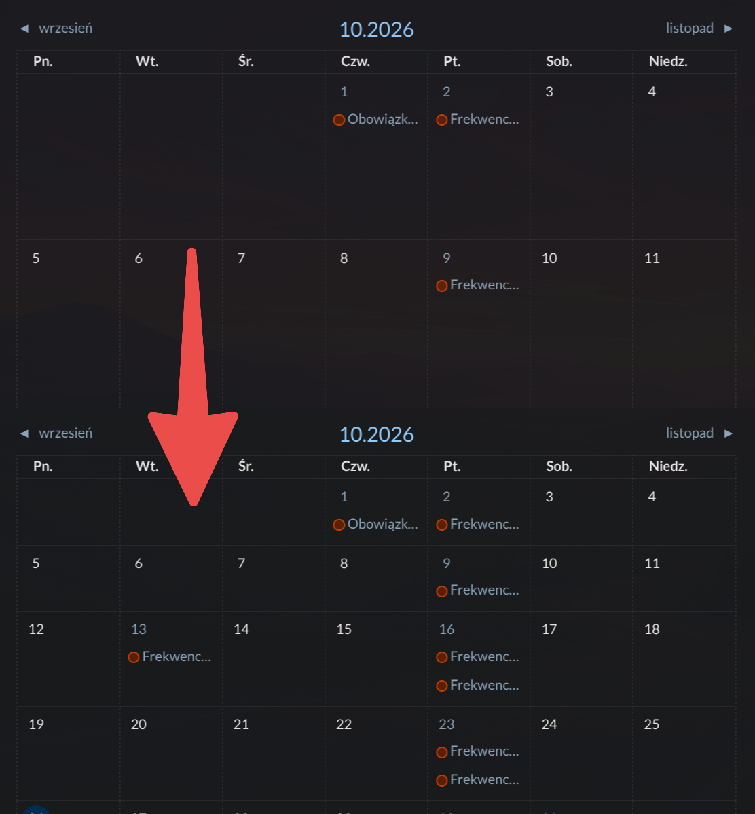
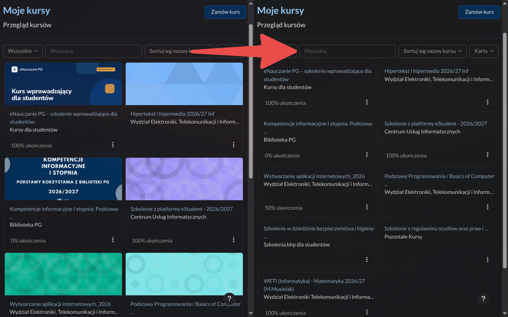
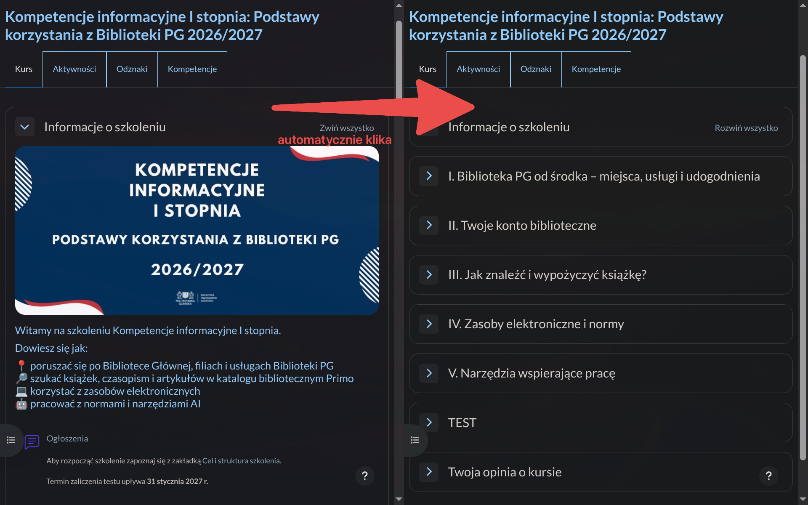

# By strony PG mniej ssały

Warto pobrać też [Dark Readera](https://darkreader.org/)

Co robi [pg_autologin](./pg_autologin/) i [stos_autologin](./stos_autologin/) raczej nie trzeba tłumaczyć

## [STOS Autosubmit](./stos_autosubmit/)

Automatycznie usuwa stare pliki i zatwierdza zmiany

## [STOS Kod](./stos_kod/)

## [Prevent Force Download](./prevent_force_download/)

## [eNauczanie Compact](./enauczanie_compact/)

